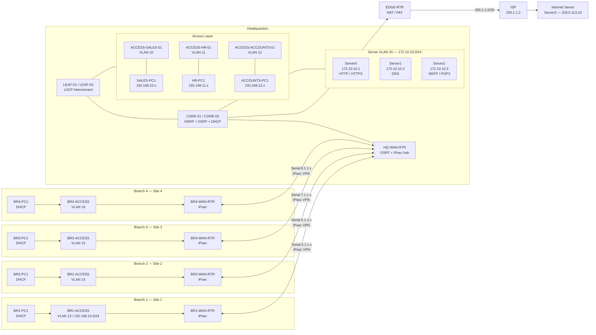

# Centralized Enterprise Server Services

[](https://www.netacad.com/courses/packet-tracer)
[](LICENSE)
[](#device-inventory)
[](#)

> A production-grade Cisco Packet Tracer lab that builds a **multi-site enterprise
> network** with **centralized DNS, HTTP/HTTPS and Email services** delivered to
> headquarters and four remote branches over an OSPF/IPsec WAN, with a PAT-enabled
> Internet edge.

> **বাংলায় পড়তে চান?** → [README.bn.md](README.bn.md)

---

## Table of Contents

- [Overview](#overview)
- [What This Lab Implements](#what-this-lab-implements)
- [Architecture](#architecture)
- [Device Inventory](#device-inventory)
- [IP Addressing (IPAM)](#ip-addressing-ipam)
- [Key Design Decisions](#key-design-decisions)
- [Repository Layout](#repository-layout)
- [Quick Start](#quick-start)
- [Verification & Testing](#verification--testing)
- [Automation & Tooling](#automation--tooling)
- [Security Hardening](#security-hardening)
- [Documentation Index](#documentation-index)
- [Credits](#credits)

---

## Overview

Most "computer network" student projects stop at a flat LAN with one server.
This project is a complete **enterprise WAN architecture** that exercises the
full range of Cisco routing and switching skills:

| Layer | Technology |
|---|---|
| Access | VLANs, access/trunk ports, port-security, STP, LACP port-channels |
| Distribution | **HSRP** first-hop redundancy on every user VLAN |
| Routing | **OSPF area 0** single-area design across 6 sites + default-route origination |
| WAN | **IPsec site-to-site VPN** (AES/SHA-HMAC) over serial links |
| Services | **DHCP**, **DNS**, **HTTP**, **HTTPS**, **SMTP**, **POP3** |
| Security | Extended **ACLs** for inter-department isolation, **PAT** at the edge |
| Internet | **NAT/PAT** + default routing to a simulated ISP + Internet server |

Everything in this repository is derived from the real lab file
[`lab/main_project.pkt`](lab/main_project.pkt) — the device configurations,
IP plan, cabling and service definitions were exported programmatically from the
Packet Tracer file rather than typed by hand, so the documentation and the lab
cannot drift apart.

---

## What This Lab Implements

### 1. Centralized DNS — `Server1` @ `172.10.10.2`

Single authoritative DNS server for the whole enterprise. Every client — HQ or
branch — receives this address automatically via DHCP.

```
www.company.com  ->  172.10.10.1   (Web Server)
mail.company.com ->  172.10.10.3   (Mail Server)
homelab.local    ->  172.10.10.2   (DNS server itself)
```

### 2. Centralized Web — `Server0` @ `172.10.10.1`

HTTP **and** HTTPS enabled, serving a custom corporate intranet portal
(`assets/web/index.html`). Reachable as `http://www.company.com` from any
site in the WAN.

### 3. Centralized Email — `Server2` @ `172.10.10.3`

SMTP domain `company.com`, POP3 for retrieval, three mailboxes:

| User | Password | Address |
|---|---|---|
| `sales` | `sales123` | `sales@company.com` |
| `hr` | `hr123` | `hr@company.com` |
| `shanto` | `shanto123` | `shanto@company.com` |

### 4. Centralized DHCP — `core-01`

One DHCP server in the HQ core hands out addressing for **all seven** user
networks (3 HQ departments + 4 branches). Branch sites use
`ip helper-address` to relay DHCP across the WAN.

### 5. Inter-Department Segmentation — `core-01`

Named extended ACLs (`SALES-SECURITY`, `HR-SECURITY`, `ACCOUNTS-SECURITY`) block
cross-department traffic while allowing DHCP and all other required flows.

### 6. Multi-Site WAN — `HQ-WAN-RTR` + 4 branch routers

OSPF area 0 spans HQ and all four branches. Branch-to-HQ traffic is protected
by IPsec site-to-site VPN (AES-256 + SHA-HMAC), with per-branch crypto maps and
matching ACLs.

### 7. Internet Edge — `EDGE-RTR` + `ISP`

PAT with overloading lets HQ users, servers and all branches reach the
simulated Internet through a **single** ISP-facing address `200.1.1.1`.

---

## Architecture



Full-resolution diagram: [`docs/images/topology.md`](docs/images/topology.md) ·
[Mermaid source](docs/images/topology.mmd)

---

## Device Inventory

42 devices. Full table with interfaces and roles:
**[`docs/DEVICE-INVENTORY.md`](docs/DEVICE-INVENTORY.md)**

| Group | Devices | Platform |
|---|---|---|
| HQ Core | `core-01`, `core-02` | Catalyst 3560-24PS |
| HQ Leaf | `leaf-01`, `leaf-02` | Catalyst 3560-24PS |
| HQ Access | `access-sales-01`, `access-hr-01`, `access-accounts-01` | Catalyst 3560-24PS |
| HQ WAN | `HQ-WAN-RTR` | Cisco 2811 |
| Internet Edge | `EDGE-RTR`, `ISP` | Cisco 2911 |
| Branches | `BR1..BR4-WAN-RTR` + `BR1..BR4-ACCESS` | 2811 + 3560-24PS |
| Servers | `Server0` (Web), `Server1` (DNS), `Server2` (Mail), `Server3` (Internet) | Server-PT |
| Endpoints | 9 HQ PCs, 8 branch PCs | PC-PT |

### Device name → hostname mapping

Packet Tracer keeps a *display name* and an IOS *hostname* independently. This
lab originally had nine devices with the hostname `Switch` and five with
`Router`, which makes CLI output ambiguous. All hostnames are now unique:

| PT display name | Hostname (CLI prompt) |
|---|---|
| `Multilayer Switch0` | `access-sales-01` |
| `Multilayer Switch1` | `access-hr-01` |
| `Multilayer Switch2` | `access-accounts-01` |
| `1.1.1.2` | `BR1-ACCESS` |
| `2.1.1.2` | `BR2-ACCESS` |
| `3.1.1.2` | `BR3-ACCESS` |
| `4.1.1.2` | `BR4-ACCESS` |
| `1.1.1.1` | `BR1-WAN-RTR` |
| `2.1.1.1` | `BR2-WAN-RTR` |
| `3.1.1.1` | `BR3-WAN-RTR` |
| `4.1.1.1` | `BR4-WAN-RTR` |
| `central router` | `HQ-WAN-RTR` |

---

## IP Addressing (IPAM)

Full table: [`docs/IPAM.md`](docs/IPAM.md)

| Purpose | Network | Gateway (HSRP) | Notes |
|---|---|---|---|
| Sales | `192.168.10.0/24` | `192.168.10.254` | ACL `SALES-SECURITY` |
| HR | `192.168.11.0/24` | `192.168.11.254` | ACL `HR-SECURITY` |
| Accounts | `192.168.12.0/24` | `192.168.12.254` | ACL `ACCOUNTS-SECURITY` |
| Branch 1 | `192.168.13.0/24` | `192.168.13.254` | DHCP relayed to `10.1.1.1` |
| Branch 2 | `192.168.14.0/24` | `192.168.14.254` | DHCP relayed to `10.1.1.1` |
| Branch 3 | `192.168.15.0/24` | `192.168.15.254` | DHCP relayed to `10.1.1.1` |
| Branch 4 | `192.168.16.0/24` | `192.168.16.254` | DHCP relayed to `10.1.1.1` |
| **Server VLAN 20** | `172.10.10.0/24` | `172.10.10.254` | Central services |
| HQ core uplink A | `10.1.1.0/24` | — | core-01 ↔ HQ-WAN-RTR |
| HQ core uplink B | `10.2.2.0/24` | — | core-02 ↔ HQ-WAN-RTR |
| HQ ↔ EDGE | `10.3.3.0/24` | — | core-01 ↔ EDGE-RTR |
| Branch LAN (rtr↔sw) | `1.1.1.0 – 4.1.1.0/24` | — | per branch |
| WAN serial | `5.1.1.0 – 8.1.1.0/24` | — | per branch, IPsec |
| Edge ↔ ISP | `200.1.1.0/30` | — | PAT translation address |
| Simulated Internet | `203.0.113.0/24` | `203.0.113.1` | ISP facing |

---

## Key Design Decisions

**Why a single DHCP server in the HQ core?**
DHCP is inherently chatty and centralised management is the whole point of the
project. `core-01` is the only DHCP server; `core-02` relays to it via
`ip helper-address`, so the active HSRP gateway always has a working DHCP path.
This is the standard Cisco "single DHCP server + relay" pattern and it is what
makes the DNS address (`172.10.10.2`) reach every client automatically.

**Why HSRP on the user VLANs?**
`core-01` holds priority 110 and `core-02` the default priority 100, so `core-01`
is active and `core-02` preempts. Both cores carry the same SVIs, so a core
failure is transparent to the client.

**Why one authoritative DNS server?**
The original lab had DNS enabled on two servers with a conflicting, malformed
record (`" mail.company.com"` — with a leading space). Split-brain DNS is a
real production defect. Only `Server1` now answers; the others have the DNS
service disabled.

**Why is the branch traffic encrypted?**
Each branch link carries site-to-site IPsec (AES / SHA-HMAC) with a matching
crypto map and ACL pair on both ends, so only the intended source/destination
pairs are tunnelled.

---

## Repository Layout

```
.
├── lab/
│   ├── main_project.pkt            # The Packet Tracer lab (9.0.1)
│   └── main_project-original.pkt   # Pristine copy of the original build
├── configs/                        # Exported running-configs, one file per device
│   ├── core-01.cfg … access-accounts.cfg
│   ├── hq-wan-router.cfg, edge-router.cfg, isp-router.cfg
│   ├── branch{1..4}-{router,access}.cfg
│   ├── servers/                    # Server service definitions + portal page
│   └── hardened/                   # Optional hardening overlays (not applied by default)
├── docs/
│   ├── ARCHITECTURE.md             # Layered design walkthrough
│   ├── DEVICE-INVENTORY.md         # Every device, interface and role
│   ├── IPAM.md                     # Every address and its purpose
│   ├── CONFIGURATION.md            # How each service is configured, step by step
│   ├── TESTING.md                  # Test plan with expected outputs
│   ├── TROUBLESHOOTING.md          # Symptoms → root cause → fix
│   ├── VIVA_QA.md                  # 40 exam questions with model answers
│   ├── NAT-PAT-ISP.md              # The PAT/Internet-edge demo script
│   ├── SECURITY.md                 # Security model & hardening roadmap
│   ├── AUDIT-FINDINGS.md           # Every issue found in the original lab + fix
│   └── images/                     # Topology diagrams
├── scripts/                        # Python automation for the lab
│   ├── pkt_export.py               # .pkt → XML → per-device configs
│   ├── audit_lab.py                # Automated lab health check
│   ├── check_ipam.py               # IPAM / duplicate-address validation
│   └── tests/
├── assets/web/index.html           # The corporate intranet page served by Server0
└── .github/                        # CI workflow, issue & PR templates
```

---

## Quick Start

### Requirements

- Cisco Packet Tracer **9.0.1** (or 8.x — the lab is backwards compatible)
- Python **3.10+** (only for the automation scripts, not to run the lab)

### Run the lab

1. Open Cisco Packet Tracer.
2. `File → Open` → [`lab/main_project.pkt`](lab/main_project.pkt).
3. Wait ~60 seconds for DHCP leases to settle and OSPF to converge.
4. Open a client (e.g. `SALES-PC1`) → `Desktop → Command Prompt`:

   ```
   C:\>ping www.company.com
   C:\>ping mail.company.com
   C:\>ipconfig
   ```

5. Open `Desktop → Web Browser` → `http://www.company.com`.
6. Open `Desktop → Email` → send from `sales@company.com` to `hr@company.com`.

### Re-export the configs from the lab

```bash
pip install -r scripts/requirements.txt
python scripts/pkt_export.py lab/main_project.pkt --out configs/
```

### Run the automated audit

```bash
python scripts/audit_lab.py lab/main_project.pkt
```

```
[PASS] 17 of 17 network devices have an exported running-config
[PASS] Every device hostname is unique
[PASS] DHCP pool DNS server matches the authoritative DNS server (172.10.10.2)
[PASS] No duplicate IP addresses across the IPAM
[WARN] 2 devices still expose FTP/TFTP on the server VLAN
...
```

---

## Verification & Testing

The full test matrix with exact commands and expected output is in
**[`docs/TESTING.md`](docs/TESTING.md)**.

| # | Test | Where | Expected |
|---|---|---|---|
| T-01 | DHCP lease | `SALES-PC1` | `192.168.10.x`, GW `.254`, DNS `172.10.10.2` |
| T-02 | DNS resolution | any PC | `www.company.com` → `172.10.10.1` |
| T-03 | DNS resolution | any PC | `mail.company.com` → `172.10.10.3` |
| T-04 | HTTP | any PC | corporate portal loads via hostname |
| T-05 | HTTPS | any PC | `https://www.company.com` loads |
| T-06 | SMTP send | `SALES-PC1` | mail queued to `hr@company.com` |
| T-07 | POP3 receive | `HR-PC1` | message present in Inbox |
| T-08 | Branch DHCP | `BR1-PC1` | `192.168.13.x`, DNS `172.10.10.2` |
| T-09 | Branch DNS | `BR1-PC1` | resolves both company names |
| T-10 | Branch HTTP | `BR1-PC1` | portal loads across the WAN |
| T-11 | Branch email | `BR1-PC1` ↔ `HR-PC1` | bidirectional mail |
| T-12 | OSPF adjacency | `core-01` | `show ip ospf neighbor` → `FULL` |
| T-13 | Default route | `BR1-WAN-RTR` | `O* 0.0.0.0/0` via OSPF |
| T-14 | HSRP | `core-01` | `core-01` Active, `core-02` Standby |
| T-15 | IPsec tunnel | `HQ-WAN-RTR` | `show crypto ipsec sa` → 4 tunnels |
| T-16 | ACL isolation | `SALES-PC1` | ping to `192.168.11.x` fails |
| T-17 | PAT | `EDGE-RTR` | `show ip nat translations` → many locals → `200.1.1.1` |
| T-18 | Internet reachability | any PC | `ping 203.0.113.10` → 0% loss |
| T-19 | Branch Internet | `BR1-PC1` | `ping 203.0.113.10` → 0% loss |
| T-20 | Port-security | `access-sales-01` | sticky MAC enforced |

---

## Automation & Tooling

Packet Tracer `.pkt` files are encrypted containers, so they cannot be diffed or
reviewed in a pull request. This repository solves that by extracting the
plaintext XML and generating everything else from it.

```bash
# decrypt a .pkt to XML (requires pkt-core)
python scripts/pkt_export.py lab/main_project.pkt --xml-only

# list every device with its model, hostname and interfaces
python scripts/pkt_export.py lab/main_project.pkt --list

# validate the lab against the documented IPAM and best-practice rules
python scripts/audit_lab.py lab/main_project.pkt --strict --allow-warning "IPsec DH group"

# unit tests for the parsers
python -m pytest scripts/tests -q
```

The CI pipeline ([`.github/workflows/ci.yml`](.github/workflows/ci.yml)) runs the
audit, the IPAM checks and the test suite on every push and pull request, so a
configuration regression is caught before it reaches a demo.

---

## Security Hardening

The lab ships in a state that is **safe for an academic demo but not for
production**. The gap is documented in
[`docs/SECURITY.md`](docs/SECURITY.md), and ready-to-apply overlays live in
[`configs/hardened/`](configs/hardened/).

Highest-impact items:

1. `no service password-encryption` is still present on 16 of 17 devices.
2. `enable` is unprotected — no `enable secret` anywhere.
3. IPsec uses IKE **group 2** with the shared pre-shared key `VPN123`.
4. FTP and TFTP are enabled on every server by default in Packet Tracer.
5. `line vty 0 4` has `login` but no `transport input ssh` restriction.

---

## Documentation Index

| Document | Purpose |
|---|---|
| [`docs/ARCHITECTURE.md`](docs/ARCHITECTURE.md) | Layer-by-layer design rationale |
| [`docs/DEVICE-INVENTORY.md`](docs/DEVICE-INVENTORY.md) | Every device, port and role |
| [`docs/IPAM.md`](docs/IPAM.md) | Every IP address, mask and purpose |
| [`docs/CONFIGURATION.md`](docs/CONFIGURATION.md) | Step-by-step service configuration |
| [`docs/TESTING.md`](docs/TESTING.md) | 20-test verification matrix |
| [`docs/TROUBLESHOOTING.md`](docs/TROUBLESHOOTING.md) | Symptom → cause → fix |
| [`docs/VIVA_QA.md`](docs/VIVA_QA.md) | Exam questions and model answers |
| [`docs/NAT-PAT-ISP.md`](docs/NAT-PAT-ISP.md) | The Internet-edge demo script |
| [`docs/SECURITY.md`](docs/SECURITY.md) | Security model & hardening roadmap |
| [`docs/AUDIT-FINDINGS.md`](docs/AUDIT-FINDINGS.md) | Issues found in the original lab and how each was fixed |
| [`docs/reference/`](docs/reference/) | Original author notes (PDF + text) |

---

## Credits

- Lab design and configuration by the project author.
- Topology diagrams: Mermaid (rendered on GitHub).
- Lab tooling built on [`pkt-core`](https://pypi.org/project/pkt-core/), an
  open-source reverse-engineering library for the Packet Tracer file format.

## License

Released under the [MIT License](LICENSE).
