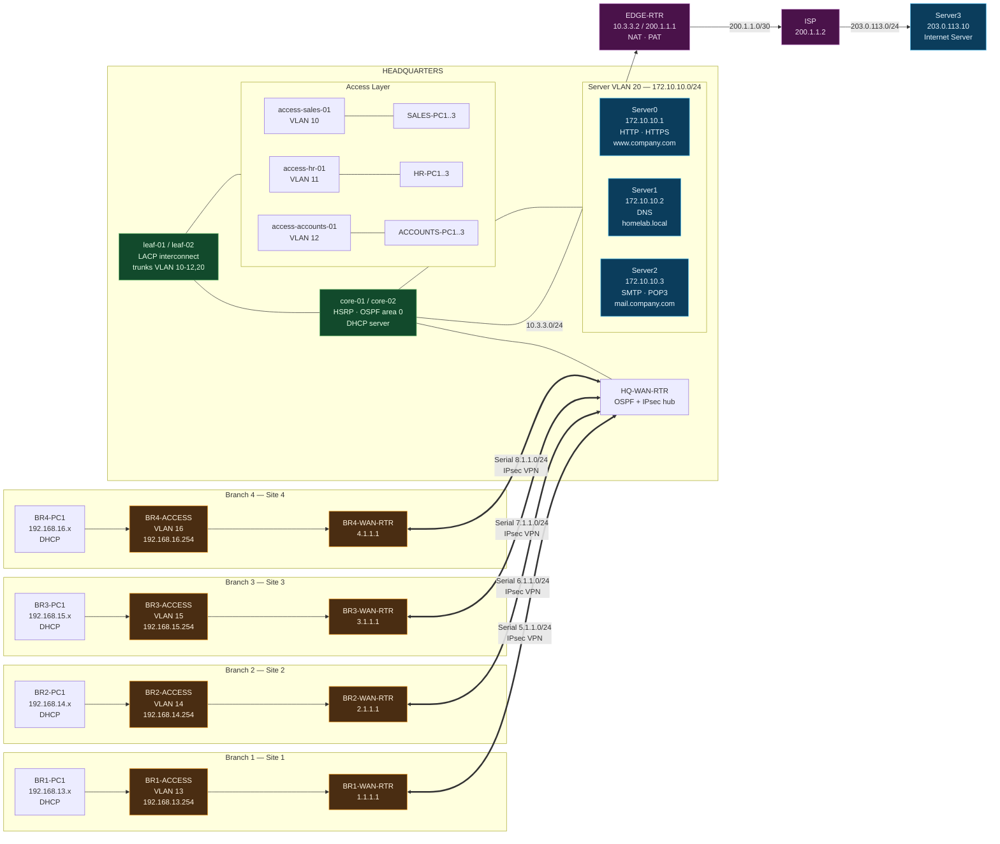

# Topology Diagrams

## Interactive diagram

Rendered automatically by GitHub from [`topology.mmd`](topology.mmd):



---

## ASCII diagram

For terminals and printed documentation:

```
                          ┌──────────────────────────────────┐
                          │        SIMULATED INTERNET         │
                          │   Server3   203.0.113.10           │
                          └────────────────┬─────────────────┘
                                           │ 203.0.113.0/24
                          ┌────────────────┴─────────────────┐
                          │            ISP  200.1.1.2        │
                          └────────────────┬─────────────────┘
                                           │ 200.1.1.0/30
                          ┌────────────────┴─────────────────┐
                          │   EDGE-RTR                       │
                          │   Gi0/0 10.3.3.2   (NAT inside)  │
                          │   Gi0/1 200.1.1.1  (NAT outside) │
                          │   PAT · overload                  │
                          └────────────────┬─────────────────┘
                                           │ 10.3.3.0/24
       ┌────────────────────────────────────┴─────────────────────────────────┐
       │                                                                      │
 ┌─────┴──────┐                                                  ┌───────────┴────────┐
 │  core-01   │◄──── 10.1.1.0/24 ────►┌──────────────┐          │      core-02       │
 │ HSRP ACTIVE│                         │  HQ-WAN-RTR  │          │  HSRP STANDBY      │
 │ DHCP SERVER│◄──── 10.2.2.0/24 ────►│ OSPF + IPsec │          │  DHCP relay        │
 │ OSPF area 0│                         │   4 tunnels  │          └───────────┬────────┘
 └─────┬──────┘                         └───┬───┬───┬───┬──────────────────────┘
       │                                     │   │   │   │
       │            ┌────────────────────────┘   │   │   └──────────┐
       │            │                            │   │              │
       │      Serial 5.1.1.0/24                 │   │              │
       │            │                     Serial 6.1.1.0/24          │
       │            ▼                            │   │              │
       │  ┌──────────────────┐                   │   │              │
       │  │  BR1-WAN-RTR     │◄──────────────────┘   │              │
       │  │  1.1.1.1/24      │                       │              │
       │  └────────┬─────────┘◄──────────────────────┘              │
       │           │ Fa0/0                                        │
       │           ▼                                              │
       │  ┌──────────────────┐  Serial 7.1.1.0/24                  │
       │  │  BR2-WAN-RTR     │◄──────────────────────┐              │
       │  │  2.1.1.1/24      │                       │              │
       │  └────────┬─────────┘                       │              │
       │           │                                 │              │
       │  ┌────────▼─────────┐  Serial 8.1.1.0/24    │              │
       │  │  BR3-WAN-RTR     │◄──────────────────────┤              │
       │  │  3.1.1.1/24      │                       │              │
       │  └──────────────────┘                       │              │
       │                                             │              │
       │  ┌──────────────────┐                       │              │
       │  │  BR4-WAN-RTR     │◄──────────────────────┘              │
       │  │  4.1.1.1/24      │                                      │
       │  └──────────────────┘                                      │
       │                                                              │
       │   ┌──────────────────────────────────────────┐             │
       │   │            LEAF LAYER                    │             │
       │   │  leaf-01  ◄──── LACP Po1 ────►  leaf-02   │             │
       │   └───┬──────────────┬──────────────────┬────┘             │
       │       │              │                  │                  │
       ▼       ▼              ▼                  ▼                  │
 ┌─────────┐ ┌─────────┐ ┌─────────┐    ┌──────────────┐            │
 │  VLAN10 │ │  VLAN11 │ │  VLAN12 │    │  SERVER VLAN │            │
 │  SALES  │ │   HR    │ │ACCOUNTS │    │      20      │            │
 │         │ │         │ │         │    │172.10.10.0/24│            │
 │ access- │ │ access- │ │ access- │    │              │            │
 │ sales-01│ │ hr-01   │ │acc-01   │    │ Server0 .1   │            │
 └─────────┘ └─────────┘ └─────────┘    │ Server1 .2   │            │
                                        │ Server2 .3   │            │
                                        └──────────────┘            │
       └────────────────────────────────────────────────────────────┘
```

---

## Layer summary

| Layer | Devices | Key technology |
|---|---|---|
| Access | `access-sales-01`, `access-hr-01`, `access-accounts-01`, `BRn-ACCESS` | VLANs, port-security, portfast/BPDU guard |
| Leaf | `leaf-01`, `leaf-02` | LACP port-channel, layer-3 trunks |
| Core | `core-01`, `core-02` | HSRP, DHCP, OSPF area 0, extended ACLs |
| Distribution / WAN | `HQ-WAN-RTR`, `BRn-WAN-RTR` | OSPF, IPsec site-to-site VPN |
| Edge | `EDGE-RTR`, `ISP` | NAT/PAT, static default routes |
| Services | `Server0`, `Server1`, `Server2` | HTTP/HTTPS, DNS, SMTP/POP3 |
| Internet | `Server3` | Simulated Internet host |

---

## Regenerating the cabling table

```bash
python scripts/pkt_export.py lab/main_project.pkt --links
```

The output is the authoritative list of all 46 cables and is mirrored in
[`../DEVICE-INVENTORY.md`](../DEVICE-INVENTORY.md).
